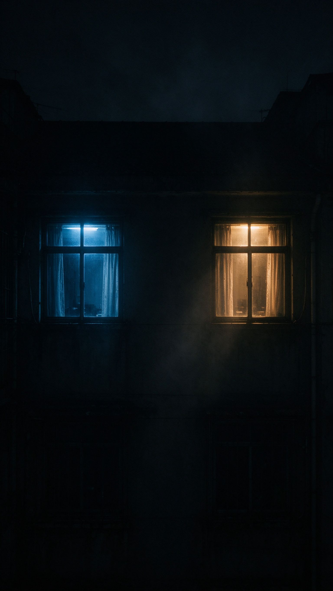
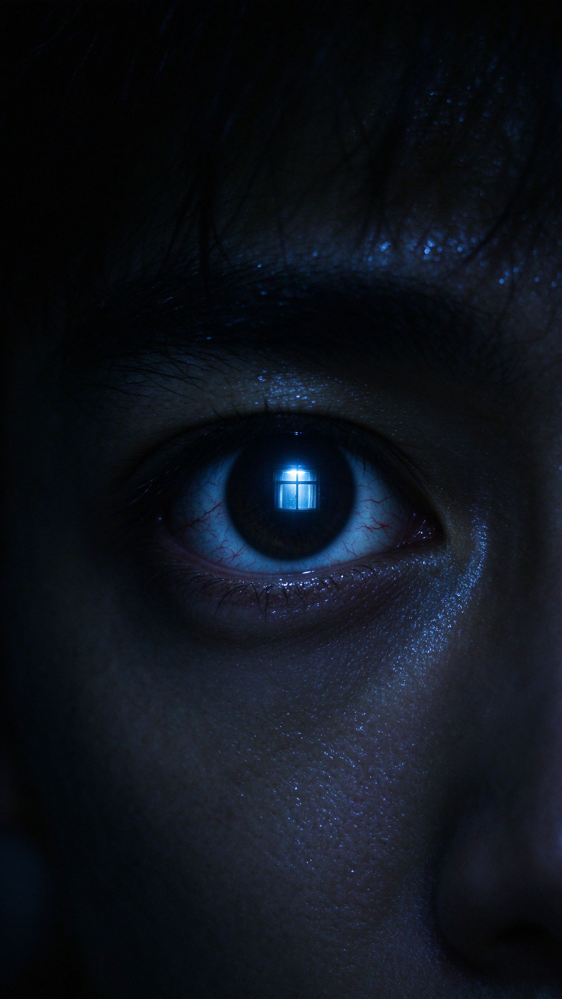
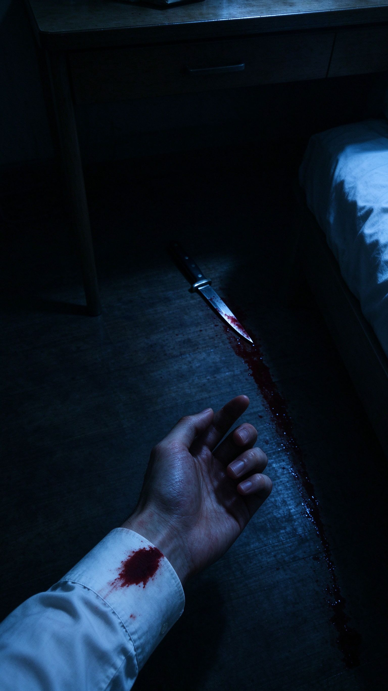
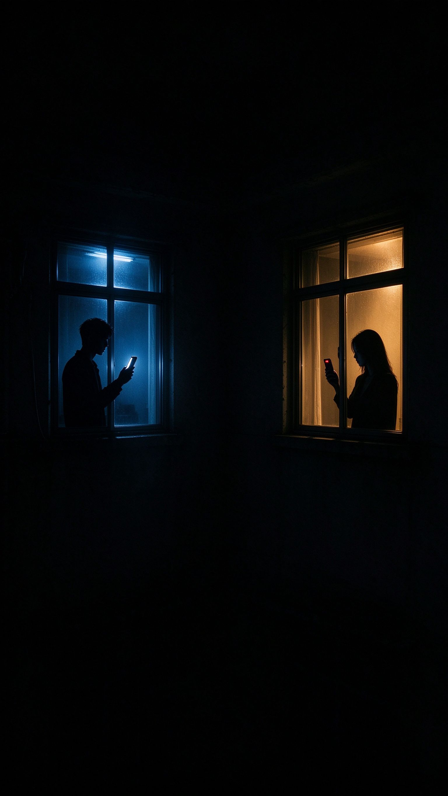

# 《对面楼》抖音 30 秒多层反转悬疑短片 · 分镜脚本

## 一、项目概览

| 项目 | 内容 |
| :--- | :--- |
| 拍摄主题 | 深夜目击对面楼"凶案"，结局目击者与被目击者身份双重反转 |
| 平台/比例 | 抖音 / 9:16 竖屏 |
| 预计时长 | 30 秒 |
| 内容类型 | 蒙太奇悬疑反转短剧（弱台词、强画面） |
| 核心受众 | 18-30 岁，喜欢悬疑、反转、找细节的观众 |
| 核心目标 | 完播率 + 评论区讨论（"到底谁是凶手"）+ 重看率 |

## 二、创意策略

> **创意切入**：你以为自己在目击凶案，其实你才是凶手；而你以为的凶手，也正握着你的证据。
>
> **前 3 秒钩子**：黑暗中一只眼睛的大特写，瞳孔里映出对面窗户的灯光，瞳孔骤然收缩——不解释、不铺垫，直接给异常。
>
> **情绪弧线**：惊恐（目击凶案）→ 急切（报警）→ 困惑（现场无异常）→ 被怀疑 → 恐惧（发现自己是凶手）→ 脊背发凉（对方也在录像）→ 细思极恐（双方互握证据，黑屏留白）。
>
> **视觉关键词**：深夜、窗帘剪影、冷暖光对撞（男主房间冷蓝 / 对面房间暖黄）、眼睛特写、手机屏幕光、两扇对望的窗。
>
> **蒙太奇手法**：前半段所有镜头都是"真的"，但镜头归属被拼错——观众默认男主是旁观者，直到镜 07 用袖口血迹、刀、拖痕把前面的画面重新归位；镜 09 再翻一次，证明对面的女人也不干净。

## 三、完整分镜表（7 列）

| 镜号 | 时长 | 景别 | 机位 | 画面内容 | 台词 | 音效/花字 |
| :--- | :--- | :--- | :--- | :--- | :--- | :--- |
| 01 | 3s | 大特写 | 平视固定 | 全黑画面中只有男主的一只眼睛，瞳孔里映出对面窗户的灯光，瞳孔骤然收缩，眼白布满血丝 | （无台词） | 低频嗡鸣 + 心跳声"咚——" |
| 02 | 3s | 中景 | POV 主观视角 | 对面楼的窗帘被室内灯光映亮，一个人影举起手臂，手中长条形物体落下，另一个人影缓缓倒地，窗帘轻轻晃动 | （无台词） | 沉闷的"咚"声，混响拉长 |
| 03 | 3s | 近景 | 俯拍固定 | 男主发抖的手指在手机屏幕上拨出"110"，冷白屏幕光打在他冒汗的脸上 | 男主（压着气声）："对面楼……杀人了。" | 拨号等待音；花字"凌晨 2:13" |
| 04 | 4s | 中景 | 平视固定 | 走廊，警察敲门；对面女人开门，暖黄灯光从她身后涌出，她表情平静，抬手整理头发 | 警察："有人报警，说你这里……" 女人（摇头，语气平淡）："就我一个人住。" | 门轴"吱呀"声 |
| 05 | 3s | 全景 | 警察 POV | 房间内一览无余：床铺平整、茶几上只有一杯水、地面干净，没有尸体、没有打斗痕迹 | （无台词） | BGM 瞬间抽空，只剩环境底噪 |
| 06 | 2s | 近景 | 平视固定 | 警察回头看向站在门外的男主，眼神从询问变成怀疑；房门在男主面前缓缓合上 | 警察："以后看清楚再报警。" | 关门声"砰" |
| 07 | 5s | 特写转近景 | 俯拍缓摇 | 男主愣在原地低头，特写：他白色衬衫袖口上一片暗红血迹；镜头顺着他的视线缓缓摇到桌下——一把刀掉在地上，地板上一道长长的拖拽痕迹一直延伸到床边 | （无台词） | 心跳声骤然放大，尖锐弦乐刺入 |
| 08 | 4s | 中景 | 仰拍固定 | 男主猛地抬头看向对面窗户；对面窗后，女人静静站着，与他对视，缓缓举起手机，屏幕上红点闪烁——正在录像 | （无台词） | 弦乐戛然而止，只剩电流"滋"声 |
| 09 | 3s | 全景（两窗对望） | 固定机位 | 男主望着对面，嘴角缓缓上扬，举起自己的手机；屏幕里是一段录像：女人在阳台弯腰拖拽一个大行李箱；镜头拉远，黑暗中两扇亮着的窗静静对望，画面切黑 | （无台词） | 一声手机消息提示音"叮"，随即全黑，出片名"对面楼" |

**总时长：30 秒（3+3+3+4+3+2+5+4+3）**

## 四、封面方案

**方案一（悬念型，推荐）**：深夜楼宇外景，两扇亮着的窗相对，一扇冷蓝、一扇暖黄，中间是大片黑暗，片名压在画面下方。
**方案二（特写型）**：男主眼睛大特写，瞳孔中映出举起刀的窗帘剪影。
**方案三（对峙型）**：两扇窗的分屏构图，左边男主举手机、右边女人举手机，红点录像灯亮着。

**方案一封面图（已生成）**：

## 五、视觉参考区（关键分镜图）

| 镜01 · 大特写 · 平视固定 | 镜07 · 特写转近景 · 俯拍缓摇 | 镜09 · 全景 · 固定机位 |
| :--- | :--- | :--- |
|  |  |  |
| 瞳孔骤缩，映出对面窗光 | 袖口血迹，桌下的刀与拖痕 | 两扇窗对望，互举手机 |

## 六、拍摄执行包

### 道具清单

| 道具名称 | 作用/用途 | 出现镜号 | 准备提示 |
| :--- | :--- | :--- | :--- |
| 白衬衫（男主） | 袖口血迹的载体，反转关键 | 01、07 | 准备 2 件，一件干净一件做血迹；血迹用糖浆+食用色素，暗红不要鲜红 |
| 道具刀 | 镜 07 揭示男主是凶手 | 02（剪影）、07 | 选无刃道具刀，刀刃做暗红色处理 |
| 手机 ×2 | 报警、录像对峙 | 03、08、09 | 提前调好屏幕常亮；录像界面可用录屏素材后期合成 |
| 一杯温水 | 证明对面房间"一切正常" | 05 | 放在茶几正中，画面要干净 |
| 大行李箱 | 镜 09 手机画面里的抛尸暗示 | 09（屏幕内） | 用普通 24 寸行李箱，重量感靠演员弯腰拖拽的动作表现 |
| 薄窗帘 | 呈现剪影 | 02 | 选浅色、透光不透形的纱帘或薄布帘 |

### 场景清单

| 场景名称 | 出现镜号 | 光线布置 | 背景/空间要求 |
| :--- | :--- | :--- | :--- |
| 男主房间 | 01-03、07-09 | 冷蓝色调，仅开手机屏幕光 + 窗外环境光，尽量暗 | 一张桌子、床、能看到"对面楼"的窗户；没有真楼时用对窗打光+剪影后期合成 |
| 走廊 | 04、06 | 走廊冷白顶灯 | 一扇房门即可，可与下面场景共用 |
| 对面女人房间 | 04、05、08、09 | 暖黄灯光，与男主房间形成强冷暖对比 | 整洁、床、茶几、薄窗帘、阳台 |

### 演员与表演

- **男主**：前半段靠"生理反应"演戏——呼吸急促、手抖、额头冒汗；镜 07 发现血迹时不要大叫，用僵住、缓慢低头、眼神从困惑到恐惧；镜 09 的笑是全片关键，要慢、要轻、要像终于反应过来，不能演成反派狂笑。
- **女人**：全程平静甚至平淡，开门时整理头发的动作要自然；镜 08 举手机时动作缓慢、眼神不躲，"我早就看着你"的从容感。
- **警察**：功能性角色，台词少，重点是镜 06 回头那个怀疑的眼神。

### 现场风险

- 血迹道具糖渍会粘灰，每条拍完及时擦拭，避免穿帮。
- 剪影镜头注意人影与窗帘的距离，贴太近会穿帮、离太远影子虚，建议距帘 30-50 厘米。
- 夜景拍摄注意手机屏幕亮度统一，避免不同镜头间忽明忽暗。

## 七、剪辑提示

1. **节奏**：01-06 每 2-4 秒一个镜头，信息推进快；镜 07 是全片最长镜头（5 秒），用缓摇让观众自己"发现"血迹和刀，不要用花字提示。
2. **关键转场**：镜 06 关门声 → 镜 07 直接进入缓摇，用"砰"的余音衔接；镜 08 抬头用视线承接对面窗户。
3. **声音设计**：全片几乎不用常规 BGM，以心跳声、低频嗡鸣、电流声为主；镜 05 房间无异常时把声音全部抽空，制造"不对劲的安静"；镜 07 弦乐刺入，镜 08 再次骤停。
4. **镜 09 收尾**：两扇窗的画面停留 1.5 秒后黑屏，黑场里放那声"叮"的提示音，再出片名，留白 0.5 秒结束。
5. **调色**：男主房间冷蓝压低饱和，女人房间暖黄略过曝，两个空间的色彩对撞是全片的视觉记忆点。

## 八、抖音平台适配

- **开头**：镜 01 直接上眼睛大特写，不要片名、不要片头，前 3 秒必须留住人。
- **花字**：全片只在镜 03 出现一次"凌晨 2:13"，其余靠画面叙事，花字过多会破坏悬疑感。
- **发布文案**：用提问引导讨论，例如"报警之后，我才发现刀在自己房间……所以到底谁是凶手？"
- **话题标签**：#悬疑 #反转 #细思极恐 #短剧 #蒙太奇
- **CTA**：结尾不硬加"点关注"，用评论区置顶引导："第二遍看窗帘，你会发现刀到底是谁的。"
- **评论区运营**：提前准备 2-3 条"伏笔解读"评论用小号发出，引导观众重看找细节。

## 九、合规与风险提醒

- 全片不出现真实尸体、血腥伤口特写，血迹仅以袖口暗红和道具暗示，避免平台限流。
- 报警情节为虚构剧情，建议在视频简介或片尾标注"剧情虚构，请勿模仿"。
- 不展示任何真实作案手法细节，刀、行李箱均为暗示性镜头。
- 结尾不做"凶手逃脱且宣扬犯罪"的价值导向，开放式留白停在"双方互握证据"，不美化犯罪。
